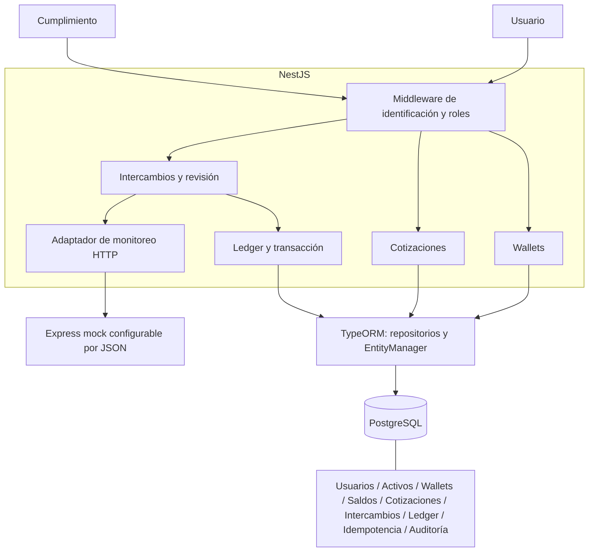
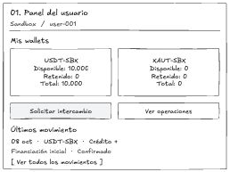
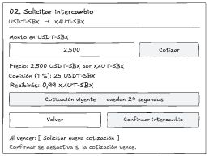
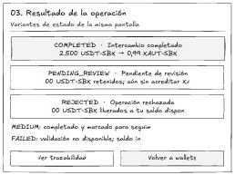
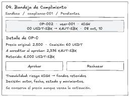
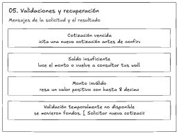
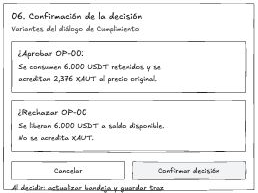

# Plataforma de activos digitales — prueba técnica

API para intercambiar **USDT-SBX por XAUT-SBX** mediante wallets internas, ledger y revisión de Cumplimiento. Los activos y el proveedor de liquidez son simulados.

## Instalación y ejecución:

Requisitos: **Node.js 22+**, npm, Docker con Docker Compose y puertos **3100, 3101 y 55432** disponibles. Ejecutar desde la raíz de este proyecto:

```sh
npm ci
cp .env.example .env
npm run up
```

El tercer comando construye e inicia PostgreSQL, el mock y la API; inicializa el esquema SQL y ejecuta el seed automáticamente. Los datos persisten en un volumen Docker.

- API: [localhost:3100](http://localhost:3100).
- Swagger público: [localhost:3100/docs](http://localhost:3100/docs); [OpenAPI JSON](http://localhost:3100/docs-json).
- Mock de cumplimiento: `http://localhost:3101`; PostgreSQL: `localhost:55432`.

Para detener los servicios: `npm run down`. Las credenciales de `.env.example` y Compose son exclusivamente de desarrollo. `.env` configura los scripts locales; las variables de los contenedores se declaran en `compose.yaml`.

## Tecnologías y arquitectura

**NestJS 11 + TypeScript** organiza módulos y middlewares; **TypeORM 0.3 + PostgreSQL 16** maneja entidades, repositorios y transacciones; **Decimal.js** evita pérdida de precisión monetaria. **Express 5** implementa el mock sin DB; **Jest, @nestjs/testing y Supertest** verifican la API con PostgreSQL real. Swagger documenta los contratos HTTP.



[Arquitectura y modelo entidad-relación](docs/architecture.md) · [Guía del código](docs/code-guide.md) · [Mockups Excalidraw de baja fidelidad](docs/mockup.md).

## Base de datos y usuarios de prueba

El seed registra USDT-SBX y XAUT-SBX en `assets`, crea una wallet por identidad y dos saldos en `wallet_assets`. El saldo inicial entra por ledger; repetir el seed, incluso simultáneamente, no agrega fondos.

| X-User-Id | Rol | USDT-SBX disponible | XAUT-SBX disponible |
|---|---|---:|---:|
| user-001 | Usuario | 10000 | 0 |
| compliance-001 | Cumplimiento | 0 | 0 |

Sin identidad válida, la API responde **401**; un rol incorrecto recibe **403**. En Swagger, ingresar la identidad en **Authorize**.

Para inicializar el esquema o ejecutar el seed por separado: `npm run db:init` y `npm run db:seed`. `synchronize: false` evita cambios automáticos de TypeORM. [Esquema SQL inicial](database/schema.sql) contiene el modelo completo con catálogo, wallets, saldos, ledger y restricciones. Repetir la inicialización no borra datos.

## Pruebas automatizadas

Con PostgreSQL iniciado:

```sh
npm test
```

Las **31 pruebas** cubren los diez escenarios exigidos: LOW exitoso, MEDIUM con seguimiento, saldo insuficiente, cotización vencida, repetición idempotente, conflicto de contenido, retención HIGH, aprobación, rechazo con liberación y aprobación sin permiso. También verifican doble gasto concurrente, rollback, decisiones simultáneas, fallos del mock, Swagger público, inicialización repetible sin pérdida de datos y seeds concurrentes. También comprueban un tercer activo, claves foráneas, unicidad de saldos y acceso por propietario.

La suite usa `TEST_DATABASE_URL` y exige una DB cuyo nombre termine en `_test`. Limpia sus datos entre casos; no usar una base compartida. Las pruebas de inicialización usan schemas temporales y el mock se ejecuta aislado. Para comprobar compilación: `npm run build`.

## Ejemplos de consumo

Consultar saldos y solicitar cotización (`id` es el saldo `wallet_assets`; `wallet_id`, su wallet contenedora):

```sh
curl http://localhost:3100/wallets -H 'X-User-Id: user-001'
curl -X POST http://localhost:3100/quotes -H 'X-User-Id: user-001' -H 'Content-Type: application/json' -d '{"amount":"2500"}'
```

Copiar el `id` devuelto en lugar de `UUID-COTIZACION` y ejecutar antes de **30 segundos**:

```sh
curl -X POST http://localhost:3100/exchanges -H 'X-User-Id: user-001' -H 'Idempotency-Key: ejemplo-001' -H 'Content-Type: application/json' -d '{"quoteId":"UUID-COTIZACION"}'
```

Para probar revisión HIGH, solicitar una nueva cotización de `6000`, ejecutar con otra clave y usar el ID del intercambio:

```sh
curl http://localhost:3100/compliance/exchanges/pending -H 'X-User-Id: compliance-001'
curl -X PATCH http://localhost:3100/compliance/exchanges/UUID-INTERCAMBIO/approve -H 'X-User-Id: compliance-001'
```

Cambiar `approve` por `reject` para liberar fondos. [Contrato completo y errores](docs/api.md).

## Reglas, supuestos y decisiones técnicas

Modelo normalizado: `users → wallets → wallet_assets ← assets`. El catálogo permite añadir activos sin cambiar el esquema; cada saldo pertenece a un activo de una wallet. El intercambio continúa limitado al par USDT-SBX → XAUT-SBX del reto; nuevos pares requieren reglas de precio y comisiones. [Diagrama relacional](docs/architecture.md).

- Precio fijo: **2500 USDT por XAUT**; comisión **1 %** descontada del origen; vigencia **30 s**. Importes como cadenas, `numeric(28,8)` y redondeo hacia abajo de XAUT. Como supuesto, la comisión también se trunca a ocho decimales. Por `2500` se reciben `0.99` XAUT.
- LOW `< 1000`: completar. MEDIUM `1000–5000`, inclusive: completar con seguimiento. HIGH `> 5000`: retener hasta aprobar o rechazar. La decisión conserva precio y comisión originales aunque la cotización haya vencido.
- Ledger y auditoría inmutables mediante triggers. Todo cambio de saldo nace de un movimiento; no se admiten saldos negativos. Débito, crédito, operación, cotización, auditoría e idempotencia se confirman o revierten juntos.
- `DataSource.transaction` y bloqueos `pessimistic_write` protegen cotización, operación y saldos de `wallet_assets`; estos se bloquean en orden de ID. El saldo se valida después del bloqueo para evitar doble gasto. SQL explícito para funciones específicas de PostgreSQL.
- Clave idempotente persistida por usuario: mismo contenido devuelve la respuesta original; otro contenido devuelve **409**. El estado actual se consulta mediante `GET /exchanges/:id`.
- El monitor se consulta antes de tomar bloqueos; después se revalidan saldo y cotización. Si falla, se registra **FAILED**, se devuelve **503** y no cambian saldos. La misma clave conserva ese resultado; un nuevo intento requiere otra clave y una cotización vigente.

El mock se ajusta en [config.json](apps/compliance-mock/config.json): umbrales, `forceFailure` y `delayMs`. Localmente relee el archivo en cada petición; en Docker, reconstruirlo con `docker compose up -d --build compliance-mock`.

## Limitaciones y mejoras para producción

Ledger simplificado por saldo de activo, sin partida doble ni inventario del proveedor; se asume liquidez suficiente. No hay frontend conectado, autenticación fuerte, emisión on-chain ni integraciones reales. Listados sin paginación; sin colas ni reintentos automáticos. La expiración se valida por fecha y no se materializa mediante una tarea programada.

Antes de producción: aplicar los controles de la respuesta 5, incorporar partida doble, paginación, conciliación y resiliencia. La revisión de dependencias detectó avisos transitivos, incluidos dos moderados en Swagger/js-yaml; deben resolverse con versiones compatibles antes de desplegar.

## 10. Preguntas de diseño

### 1. Emisión y colocación

**Pregunta:** ¿Cómo ampliaría la solución para soportar emisión de activos por tramos y una colocación inicial, evitando que lo colocado supere el suministro autorizado?

**Respuesta:** Modelaría activos, tramos, suministro autorizado y colocaciones. En una transacción bloquearía el tramo y validaría `colocado + reservado + solicitud <= autorizado`; cada reserva y colocación sería idempotente y auditable. Al liquidar convertiría reserva en colocación sin contarla dos veces. Mantendría un límite agregado por activo y separaría autorización y ejecución.

### 2. Transferencias

**Pregunta:** ¿Cómo implementaría transferencias internas entre usuarios preservando atomicidad, idempotencia y trazabilidad?

**Respuesta:** Bloquearía los saldos de `wallet_assets` origen y destino del mismo activo en orden estable, comprobaría propietario y saldo, y registraría débito, crédito, operación, auditoría y clave idempotente en una sola transacción. Ninguna transferencia podría confirmarse parcialmente; las correcciones serían movimientos compensatorios, sin editar el historial.

### 3. Custodia

**Pregunta:** ¿Cómo conciliaría el total del ledger interno contra una wallet omnibus administrada mediante Fireblocks o una solución equivalente?

**Respuesta:** Conciliaría por activo y corte temporal el saldo omnibus con los pasivos del ledger —disponible más retenido— y los saldos propios de tesorería. Separaría operaciones pendientes, comisiones y confirmaciones on-chain para evitar diferencias aparentes. Guardaría cada conciliación, alertaría diferencias y aplicaría revisión independiente antes de corregirlas, sin sobrescribir saldos para forzar el cuadre.

### 4. Cumplimiento

**Pregunta:** ¿Cómo manejaría la indisponibilidad temporal de herramientas como Sumsub o Chainalysis sin permitir operaciones que requieran validación previa?

**Respuesta:** Si Sumsub o Chainalysis no responde, no autorizaría ejecución por defecto. Mantendría la solicitud fallida o pendiente de validación, con reintentos acotados, backoff, circuit breaker y cola/outbox. Solo continuaría tras completar las validaciones obligatorias; una revisión humana no las omitiría. Toda decisión quedaría auditada.

### 5. Producción

**Pregunta:** ¿Qué controles técnicos, operativos y de seguridad implementaría antes de desplegar esta solución en una plataforma regulada?

**Respuesta:** Sustituiría `X-User-Id` por OIDC/OAuth2 con tokens verificados, roles y permisos por recurso; añadiría MFA y segregación de funciones para operadores. Implementaría TLS, gestión de secretos, límites operativos, rate limiting, roles DB restringidos, auditoría protegida, monitoreo, backups/PITR y pruebas de restauración. Completaría conciliación, respuesta a incidentes, revisión de seguridad y validación de requisitos regulatorios aplicables antes de operar.

### 6. Emisión on-chain

**Pregunta:** ¿Qué componentes deberían mantenerse separados entre la lógica interna de la plataforma, el contrato inteligente, la custodia, la auditoría del contrato y la validación del activo de respaldo?

**Respuesta:** Separaría dominio y ledger interno; contratos de emisión y control de suministro; adaptador blockchain; custodia y políticas de firma; auditoría independiente del contrato; y validación independiente del activo de respaldo. Usaría procesos idempotentes para coordinar estados internos y confirmaciones on-chain. La auditoría del contrato no demuestra por sí sola la existencia del respaldo.

## Tiempo empleado y uso de IA

**Tiempo aproximado:** 3 a 4 horas incluyendo implementación, revisión y preparación de la sustentación.

**IA utilizada:** Codex, como apoyo para implementación NestJS/Express, pruebas y documentación.

## Mockups de baja fidelidad

Las seis vistas realizadas en Excalidraw se conservan como imágenes en [`docs/mockups`](docs/mockups). Son capturas del lienzo; 

### 1. Panel del usuario



### 2. Solicitud de intercambio



### 3. Resultado de la operación



### 4. Bandeja de Cumplimiento



### 5. Validaciones y recuperación



### 6. Confirmación de la decisión



[Ver el lienzo completo](docs/mockups/vista-general.png).

[Diagrama de base de datos para DrawDB (DBML)](docs/database.drawdb.dbml).
