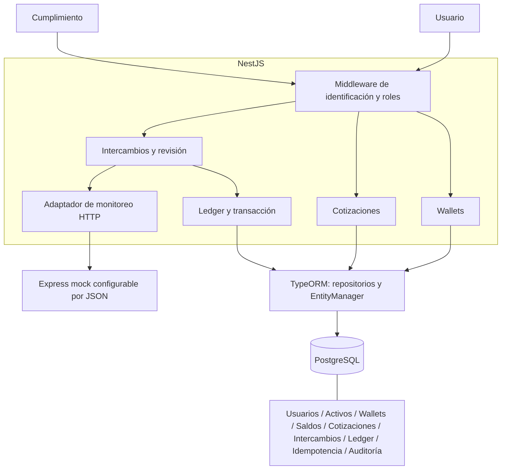
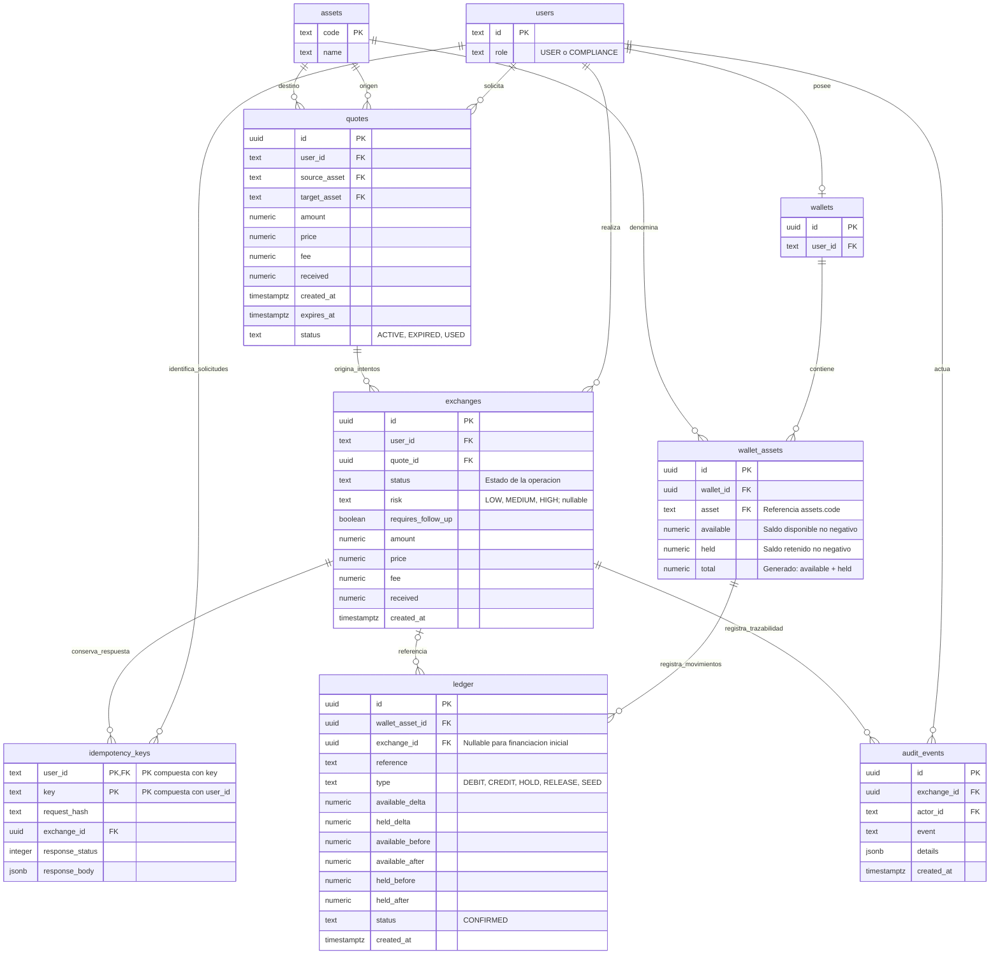

# Arquitectura



El proveedor de liquidez tiene inventario supuesto suficiente; no necesita componente real. Consulta externa antes del bloqueo; transacción y revalidación para todos los cambios monetarios.

## Modelo entidad-relación de PostgreSQL

El diagrama refleja las tablas financieras y claves de `database/schema.sql`, mapeadas en `apps/api/src/database/entities/`. `PK` indica clave primaria y `FK` clave foránea. Los campos monetarios `numeric` usan precisión `numeric(28,8)`.




## Persistencia con TypeORM

Los módulos registran repositorios por entidad. Las lecturas usan repositorios inyectados; las escrituras monetarias usan repositorios obtenidos del `EntityManager` de la transacción. `pessimistic_write` genera los bloqueos PostgreSQL. Los triggers y checks siguen siendo la última defensa del ledger; no se reemplazan por lógica exclusiva del ORM.

## Inicialización

`npm run db:init` aplica `database/schema.sql` en una transacción. El esquema incluye el catálogo `assets`, una wallet por usuario y los saldos en `wallet_assets`, con unicidad `(wallet_id, asset)`. El ledger referencia cada saldo por `wallet_asset_id`. El seed crea los activos y datos de prueba sin duplicar fondos.

`GET /wallets` devuelve saldos por activo: `id` identifica el saldo y `wallet_id` su contenedor. `/wallets/:id/movements` recibe el ID de saldo. El catálogo admite nuevos activos; el intercambio sigue usando el par del reto.

## Diagrama para DrawDB (DBML)

[Descargar el modelo DBML](database.drawdb.dbml) y usar la importación DBML de la plataforma, o copiar el siguiente contenido. Las nueve tablas y sus claves foráneas corresponden a `database/schema.sql`. Los UUID se generan con `gen_random_uuid()`; no son enteros autoincrementales. La propiedad `headercolor` conserva el formato del ejemplo.

La visualización incluye la PK compuesta de `idempotency_keys` y la unicidad `(wallet_id, asset)`. Los checks monetarios, estados permitidos, índices parciales y triggers se mantienen en el SQL. `ledger.exchange_id` es opcional para la financiación inicial; `wallet_assets.total` es una columna generada.

```dbml
// Modelo PostgreSQL de database/schema.sql.
// Los checks, índices parciales y triggers se definen en el SQL.

Table users [headercolor: #175e7a] {
  id text [pk, not null]
  role text [not null]
}

Table assets [headercolor: #175e7a] {
  code text [pk, not null]
  name text [not null]
}

Table wallets [headercolor: #175e7a] {
  id uuid [pk, not null, default: `gen_random_uuid()`]
  user_id text [not null, unique]
}

Table wallet_assets [headercolor: #175e7a] {
  id uuid [pk, not null, default: `gen_random_uuid()`]
  wallet_id uuid [not null]
  asset text [not null]
  available numeric(28,8) [not null, default: 0]
  held numeric(28,8) [not null, default: 0]
  total numeric(28,8) [note: 'Generado en PostgreSQL: available + held']

  indexes {
    (wallet_id,asset) [unique]
  }
}

Table quotes [headercolor: #175e7a] {
  id uuid [pk, not null, default: `gen_random_uuid()`]
  user_id text [not null]
  source_asset text [not null, default: 'USDT-SBX']
  target_asset text [not null, default: 'XAUT-SBX']
  amount numeric(28,8) [not null]
  price numeric(28,8) [not null]
  fee numeric(28,8) [not null]
  received numeric(28,8) [not null]
  created_at timestamptz [not null, default: `clock_timestamp()`]
  expires_at timestamptz [not null]
  status text [not null, default: 'ACTIVE']
}

Table exchanges [headercolor: #175e7a] {
  id uuid [pk, not null, default: `gen_random_uuid()`]
  user_id text [not null]
  quote_id uuid [not null]
  status text [not null]
  risk text
  requires_follow_up boolean [not null, default: false]
  amount numeric(28,8) [not null]
  price numeric(28,8) [not null]
  fee numeric(28,8) [not null]
  received numeric(28,8) [not null]
  created_at timestamptz [not null, default: `clock_timestamp()`]
}

Table idempotency_keys [headercolor: #175e7a] {
  user_id text [not null]
  key text [not null]
  request_hash text [not null]
  exchange_id uuid [not null]
  response_status integer [not null]
  response_body jsonb [not null]

  indexes {
    (user_id,key) [pk]
  }
}

Table ledger [headercolor: #175e7a] {
  id uuid [pk, not null, default: `gen_random_uuid()`]
  wallet_asset_id uuid [not null]
  exchange_id uuid
  reference text [not null]
  type text [not null]
  available_delta numeric(28,8) [not null]
  held_delta numeric(28,8) [not null]
  available_before numeric(28,8) [not null]
  available_after numeric(28,8) [not null]
  held_before numeric(28,8) [not null]
  held_after numeric(28,8) [not null]
  status text [not null, default: 'CONFIRMED']
  created_at timestamptz [not null, default: `clock_timestamp()`]
}

Table audit_events [headercolor: #175e7a] {
  id uuid [pk, not null, default: `gen_random_uuid()`]
  exchange_id uuid [not null]
  actor_id text [not null]
  event text [not null]
  details jsonb [not null, default: '{}']
  created_at timestamptz [not null, default: `clock_timestamp()`]
}

Ref: wallets.user_id - users.id
Ref: wallet_assets.wallet_id > wallets.id
Ref: wallet_assets.asset > assets.code
Ref: quotes.user_id > users.id
Ref: quotes.source_asset > assets.code
Ref: quotes.target_asset > assets.code
Ref: exchanges.user_id > users.id
Ref: exchanges.quote_id > quotes.id
Ref: idempotency_keys.user_id > users.id
Ref: idempotency_keys.exchange_id > exchanges.id
Ref: ledger.wallet_asset_id > wallet_assets.id
Ref: ledger.exchange_id > exchanges.id
Ref: audit_events.exchange_id > exchanges.id
Ref: audit_events.actor_id > users.id
```
