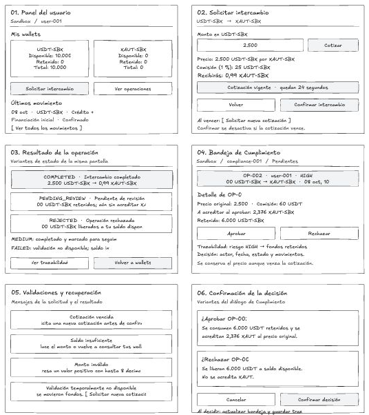

# Mockups de baja fidelidad — Excalidraw

[Archivo editable Excalidraw original](mockups/mockups-activos-digitales.excalidraw) · [Vista general PNG](mockups/vista-general.png).

Para editar, abrir [Excalidraw](https://excalidraw.com) y arrastrar el archivo `.excalidraw` al lienzo, o elegir **Abrir** en su menú. Cada pantalla está agrupada para moverla y editarla. El archivo incluye seis vistas; se puede exportar el lienzo completo o seleccionar una pantalla para exportarla.

Los PNG conservan la apariencia del lienzo Excalidraw después de los ajustes de texto. Se guardaron como capturas porque el exportador externo quedó en “Exporting…”. El archivo editable corresponde a la versión original; los últimos ajustes realizados en la app se conservan en las imágenes. Se representan flujos y estados, sin frontend conectado ni diseño visual definitivo. Los importes y fechas son ejemplos.

| Vista | Alcance |
|---|---|
| [01. Panel del usuario](mockups/01-panel-usuario.png) | Wallets USDT-SBX/XAUT-SBX, saldos disponible, retenido y total; últimos movimientos y acceso al intercambio. |
| [02. Solicitud](mockups/02-solicitud-intercambio.png) | Monto, precio, comisión, XAUT estimado, vigencia y confirmación. |
| [03. Resultado](mockups/03-resultados.png) | Completado, pendiente de revisión, rechazado, seguimiento MEDIUM e indisponibilidad del monitor. |
| [04. Cumplimiento](mockups/04-cumplimiento.png) | Operación retenida con usuario, monto, activo, riesgo y fecha; detalle, aprobar/rechazar y trazabilidad. |
| [05. Validaciones](mockups/05-validaciones.png) | Cotización vencida, saldo insuficiente, monto inválido y recuperación ante indisponibilidad. |
| [06. Confirmación](mockups/06-confirmacion-decision.png) | Consecuencias de aprobar o rechazar, con cancelar/confirmar. |

## Coherencia con el backend

- **Cotización:** 2.500 USDT-SBX, comisión 25 y recepción de 0,99 XAUT-SBX. La vigencia inicial es 30 segundos; el mockup muestra 24 segundos restantes. Al vencer se desactiva confirmar y se ofrece una nueva cotización.
- **MEDIUM:** el intercambio se completa y queda marcado para seguimiento; no requiere aprobación previa.
- **HIGH:** 6.000 USDT-SBX quedan retenidos, sin crédito de XAUT. Aprobar consume retenido y acredita 2,376 XAUT-SBX; rechazar libera USDT sin acreditar XAUT. Se conservan precio y comisión originales aunque la cotización haya vencido.
- **Fallos:** monto inválido, saldo insuficiente, vencimiento o fallo de monitoreo no generan movimientos monetarios. La creación reenviada conserva su clave idempotente; un nuevo intento tras FAILED usa otra clave y una cotización vigente.
- **Trazabilidad:** usuario y Cumplimiento pueden revisar los eventos permitidos por su rol. La decisión registra actor, fecha y estado.

Las tarjetas de estados y los diálogos muestran variantes independientes de una pantalla, no estados simultáneos de una operación.

